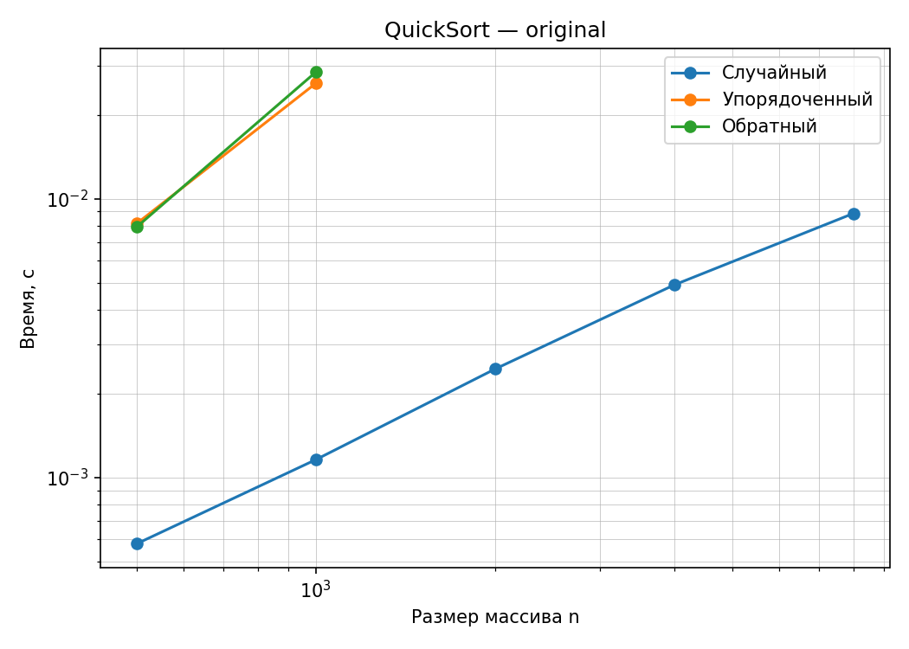
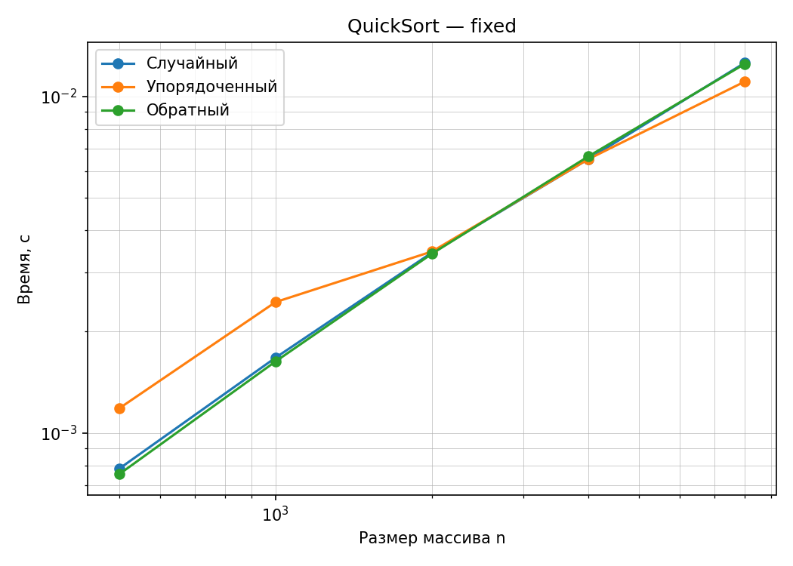

## МИНИСТЕРСТВО ЦИФРОВОГО РАЗВИТИЯ И МАССОВЫХ КОММУНИКАЦИЙ РОССИЙСКОЙ ФЕДЕРАЦИИ
## Ордена Трудового Красного Знамени федеральное государственное бюджетное образовательное учреждение «Московский технический университет связи и информатики»

### Отчёт по дополнительному практическому заданию № 1: «Верификация ИИ-сгенерированной сортировки»
### **Выполнил:** студент группы БВТ-2502, Провкин Алексей Сергеевич

___

**Цель:** провести четырёхэтапную верификацию ИИ-сгенерированной реализации QuickSort, выявить дефекты корректности и производительности, обосновать вердикт о применимости, исправить обнаруженные недостатки и повторно проверить алгоритм.

___

## Информация

**Версия Python:** Python 3.10.11  
**Процессор:** Intel Core i5-10500H (базовая частота 2,5 ГГц, максимальная — 4,5 ГГц).  
**Вариант:** 10; **seed:** `30 + 10 = 40`.

Случайные входы определяются вариантом и порядком обращений к генератору. В исправленной версии отдельный генератор `random.Random(40)` для выбора опорных элементов создаётся один раз и передаётся по рекурсии; его состояние сохраняется между вызовами сортировки. Генерация входов использует независимый поток. Поэтому при повторении полного запуска воспроизводятся входы и последовательность опорных элементов; измеренное время может различаться.

___

## Ход выполнения работы

1. Изучен исходный код `dz01-ai-code.py` и заявленные в документации свойства: время `O(n log n)`, стек рекурсии `O(log n)`, сохранение исходного списка и возврат нового отсортированного списка.
2. Реализованы проверки двух инвариантов: упорядоченности результата и сохранения мультимножества элементов.
3. Подготовлены репрезентативные входы: пустой массив, один и два элемента, равные элементы, упорядоченный и обратно упорядоченный массивы, случайный массив с отрицательными числами и дубликатами.
4. Проведено сравнение с эталонной функцией `sorted()` на 300 случайных массивах разных размеров.
5. Выполнены замеры времени на трёх классах входов с прогревом, пятью повторениями и вычислением медианы. Для аварийных завершений зафиксирован `RecursionError`.
6. Составлен вердикт для исходной реализации; подготовлена исправленная версия сортировки с рандомизированным выбором опорного элемента и сохранением всех равных элементов.
7. Проведена повторная верификация и построены графики зависимости времени от размера массива.

___

## Проверка корректности: шаги 1–3

### Инварианты сортировки

При проверке использованы два инварианта:

1. **Упорядоченность:** для каждой соседней пары выполняется `result[i] <= result[i + 1]`. Проверка реализована функцией `is_sorted()`.
2. **Сохранение элементов:** результат должен содержать те же значения с теми же кратностями, что и исходный массив. Проверка реализована функцией `same_multiset()` с использованием `collections.Counter`.

Одной упорядоченности недостаточно: результат `[1, 2, 3]` отсортирован, но не является корректной сортировкой массива `[1, 2, 2, 3]`, поскольку один элемент утрачен.

Самопроверка вспомогательных функций завершилась сообщением:

```text
self_check: OK
```

### Репрезентативные тесты

| Класс входа | Исходный QuickSort | Исправленный QuickSort |
|---|---|---|
| Пустой массив | OK | OK |
| Один элемент | OK | OK |
| Два разных элемента | OK | OK |
| Все элементы одинаковые | Нарушено сохранение элементов | OK |
| Упорядоченный массив | OK | OK |
| Обратно упорядоченный массив | OK | OK |
| Два одинаковых элемента | Нарушено сохранение элементов | OK |
| Случайный массив с повторами | Нарушено сохранение элементов | OK |

Проверки упорядоченного и обратно упорядоченного входов малого размера не обнаружили ошибок корректности, однако последующие бенчмарки выявили проблемы производительности на больших входах.

### Сравнение с `sorted()`

| Проверка | Исходная версия | Исправленная версия |
|---|---:|---:|
| Количество случайных входов | 300 | 300 |
| Расхождений с эталоном | **224** | **0** |
| Доля расхождений | **74,7%** | **0%** |

Минимальный по длине контрпример среди случайных входов исходного прогона: `[7, 7, 2, 6]`. Ещё более короткий контрпример выявлен репрезентативной проверкой:

```python
input_data = [2, 2]
# Исходный QuickSort: [2]
# sorted(input_data): [2, 2]
```

Результат остаётся упорядоченным, но нарушает инвариант сохранения элементов. После исправления все 300 случайных сравнений завершились без расхождений.

В исходной реализации каждое различное значение попадает в результат только один раз: фактически результат совпадает с `sorted(set(input_data))`. Поэтому обнаруженные расхождения связаны с дубликатами, а доля 74,7% характеризует именно выбранные 300 тестов, а не вероятность ошибки на произвольных данных.

___

## Найденные дефекты исходного кода

### Дефект 1. Потеря повторяющихся элементов

**Симптом:** результат содержит меньше элементов, чем входной массив.  
**Выявивший класс входов:** массивы с дубликатами, в том числе `[2, 2]` и массивы из одинаковых значений.  
**Причина:** в исходном `dz01-ai-code.py` строки разбиения отбирают только значения `x < pivot` и `x > pivot`, а при объединении возвращается одна копия `pivot`. Остальные равные значения отбрасываются:

```python
smaller = [x for x in data if x < pivot]
larger = [x for x in data if x > pivot]
return quicksort(smaller) + [pivot] + quicksort(larger)
```

**Исправление:** отдельная группа `equal`, содержащая все значения, равные опорному элементу, включается в возвращаемый результат.

### Дефект 2. Неудачный выбор опорного элемента

**Симптом:** резкий рост времени на упорядоченном и обратно упорядоченном входах, затем `RecursionError`.  
**Выявивший класс входов:** упорядоченные и обратно упорядоченные массивы больших размеров.  
**Причина:** строка `pivot = data[0]` выбирает крайний элемент. Для монотонного массива уникальных значений одно подмножество оказывается пустым, другое — размером `n - 1`; разбиение вырождается в последовательную рекурсию.

**Аналитическая оценка:** `T(n) = T(n - 1) + O(n)`, следовательно, худшее время — `O(n²)`, глубина рекурсии — `O(n)` вместо заявленного `O(log n)`.

**Исправление:** случайный выбор опорного элемента уменьшает вероятность систематически несбалансированных разбиений. Ожидаемое время рандомизированного QuickSort — `O(n log n)`, худшее остаётся `O(n²)`.

### Уточнение оценки дополнительной памяти

**Заявленное свойство:** docstring указывает `O(log n)` именно для стека рекурсии, а не для всей дополнительной памяти. Эта оценка стека неприменима к худшему случаю исходной реализации; кроме того, общий расход памяти требует отдельного анализа.

**Причина:** на каждом рекурсивном шаге создаются списки разбиения и промежуточные списки при конкатенации; на вырожденных входах их объёмы на активных уровнях рекурсии накапливаются.  
**Аналитическая оценка:** худший объём дополнительной памяти исходной реализации может достигать `O(n²)`; только стек рекурсии в худшем случае требует `O(n)`.

**После исправления:** трёхстороннее разбиение по-прежнему создаёт дополнительные списки. Ожидаемая дополнительная память составляет `O(n)`, худшая — `O(n²)`; глубина стека составляет соответственно `O(log n)` в ожидании и `O(n)` в худшем случае. Эти оценки относятся к алгоритму при произвольном числе различных значений; фактическое число активных рекурсивных вызовов также ограничено лимитом интерпретатора. В данной работе память непосредственно не измерялась: оценки получены аналитически.

___

## Шаг 4. Измерения времени работы

Замеры проводились на трёх классах входных данных: **случайном, упорядоченном и обратно упорядоченном**. На каждую точку приходился один прогрев и пять повторных запусков; в таблицах приведена медиана, секунды. Использованы размеры `500, 1000, 2000, 4000, 8000`.

Каждый массив генерируется заранее из целых чисел диапазона `[-1000; 1000]`, после чего при необходимости упорядочивается. В пределах одной точки все повторы используют один и тот же массив. Входы разных классов генерируются последовательно, поэтому имеют одинаковые размеры и диапазон значений, но не обязательно одинаковое мультимножество. Таблицы ниже приведены по сохранённым журналам [исходной](test_results_AI.txt) и [исправленной](test_results_FIXED.txt) версий.

### Исходная сортировка

| Размер, n | Случайный, с | Упорядоченный, с | Обратный, с |
|---:|---:|---:|---:|
| 500 | 0,000506 | 0,009277 | 0,006862 |
| 1000 | 0,001014 | 0,023997 | 0,022628 |
| 2000 | 0,002175 | RecursionError | RecursionError |
| 4000 | 0,004278 | RecursionError | RecursionError |
| 8000 | 0,007627 | RecursionError | RecursionError |

При `n = 1000` упорядоченный вход обрабатывался примерно в 24 раза дольше случайного. Начиная с `n = 2000` на обоих монотонных классах входов зафиксировано аварийное завершение. Это согласуется с аналитической оценкой худшего случая `O(n²)` и линейной глубиной рекурсии.

В этих замерах встречаются дубликаты, поэтому глубина вырожденной рекурсии определяется числом различных значений `u`, а не непосредственно длиной `n`. При `n = 1000` в обоих монотонных массивах менее 800 различных значений, а при `n = 2000` — по 1273. Поэтому порог `RecursionError` зависит от состава данных и лимита рекурсии, а не является универсальным ограничением QuickSort на массивы длины 2000. Из двух успешных точек для каждого монотонного класса нельзя экспериментально установить точную асимптотику; квадратичная оценка худшего случая обоснована рекуррентным соотношением для уникальных ключей.

### Исправленная сортировка

| Размер, n | Случайный, с | Упорядоченный, с | Обратный, с |
|---:|---:|---:|---:|
| 500 | 0,000780 | 0,000736 | 0,000820 |
| 1000 | 0,001606 | 0,001470 | 0,001661 |
| 2000 | 0,003296 | 0,003364 | 0,003379 |
| 4000 | 0,007030 | 0,005941 | 0,006161 |
| 8000 | 0,012119 | 0,011573 | 0,009852 |

Во всех измеренных точках исправленная реализация завершилась успешно. Времена трёх классов входов стали близкими; при увеличении размера с 1000 до 8000 элементов время увеличилось приблизительно в 7,5 раза для случайного, 7,9 раза для упорядоченного и 5,9 раза для обратного входа. Наблюдения показывают отсутствие прежней систематической деградации на монотонных входах в проверенном диапазоне, но не доказывают строгую верхнюю оценку `O(n log n)` для любого входа.

Диапазон генерации содержит всего 2001 возможное значение. Трёхстороннее разбиение удаляет из дальнейшей рекурсии сразу всю группу равных опорному элементов, поэтому число различных значений существенно влияет на время. При росте `n` и фиксированном диапазоне рост времени может быть близким к линейному. Такие данные позволяют проверить работу с дубликатами и устойчивость к порядку элементов, но не позволяют надёжно отличить `O(n)` от `O(n log n)` для массивов уникальных ключей.

**Оговорка при сравнении:** исходная программа удаляет дубликаты, поэтому на случайных данных она выполняет меньше полезной работы, чем корректная версия. По этой причине абсолютные времена случайного входа нельзя трактовать как честное сравнение скорости двух корректных сортировок.

Сохранённые журналы фиксируют отдельные выполненные прогоны; текущий скрипт использует один продолжающийся поток опорных элементов. Поэтому точное совпадение времён с журналами не является критерием воспроизводимости. Для сравнения производительности после изменения схемы случайности обе версии следует измерять в одинаковых условиях; приведённые результаты не используются для утверждения о точном коэффициенте ускорения исправленной версии.

___

## Графики

Построены графики зависимости времени сортировки от размера входного массива в логарифмических осях (`log-log`) с использованием `matplotlib`. Для каждой версии изображены три класса входов. Точки с `RecursionError` не считаются нулевым временем и на графике исходной реализации отсутствуют.

Графики показывают повторные замеры; числовые значения в таблицах взяты из текстовых журналов. Поэтому графики используются для оценки общей тенденции, а приведённые отношения времён рассчитаны по таблицам.

**Исходная реализация:**



**Исправленная реализация:**



___

## Вердикт о применимости

**Исходная реализация — отклонить.** Она нарушает инвариант сохранения элементов на массивах с повторениями, расходится с `sorted()` в 224 из 300 проверок, деградирует на монотонных входах и аварийно завершается на больших массивах. Заявленные оценки сложности и памяти не отражают худшего случая и дополнительных выделений памяти.

**Исправленная реализация — принять для учебной задачи сортировки целых чисел.** На проверенных тестах нарушений корректности не выявлено: все репрезентативные тесты пройдены, расхождений с `sorted()` нет, все точки бенчмарка выполнены без `RecursionError`. Корректность разбиения обосновывается тем, что каждый элемент входит ровно в одну из групп `smaller`, `equal`, `larger`; группа `equal` непуста, а размеры рекурсивных подзадач строго меньше исходного. После сортировки подзадач конкатенация сохраняет все элементы и даёт неубывающий порядок. Возвращаемые списки создаются заново, исходный список не изменяется. Однако реализация по-прежнему имеет худшее время `O(n²)`, худшую дополнительную память `O(n²)` и может превысить лимит рекурсии при неудачных разбиениях. Она не обеспечивает гарантированного времени и успешного завершения для любых размеров входа.

___

## Вывод

В ходе выполнения дополнительного задания была проведена полная четырёхэтапная верификация ИИ-сгенерированной сортировки QuickSort. Проверка показала, что наличие правдоподобного docstring и успешное выполнение простых примеров не гарантируют корректность программы.

Основной функциональный дефект исходной версии — потеря повторяющихся элементов. На 300 случайных входах выявлено 224 расхождения с эталоном. На монотонных входах экспериментально зафиксированы замедление и аварийные завершения из-за чрезмерной глубины рекурсии; квадратичная сложность худшего случая установлена аналитически.

Исправленная версия использует рандомизированный выбор опорного элемента и сохранение всех значений, равных ему. Повторная верификация не выявила расхождений с `sorted()` и показала сопоставимое время выполнения на трёх классах входных данных. При этом вероятностный выбор опорного элемента не устраняет теоретический худший случай `O(n²)`, а разбиение с созданием списков требует дополнительной памяти.

Таким образом, верификация ИИ-сгенерированного кода должна включать проверку инвариантов, репрезентативные тесты, сравнение с эталоном, аналитическую оценку сложности и экспериментальные замеры, а обнаруженные дефекты должны подтверждаться воспроизводимыми примерами.

___

## Использование ИИ

При выполнении работы использовался ChatGPT для объяснения тестовых проверок, обсуждения ошибок реализации, рекомендаций по исправлению сортировки и подготовки текста отчёта. Результаты исходной и исправленной реализаций проверялись с помощью разработанного скрипта верификации.
