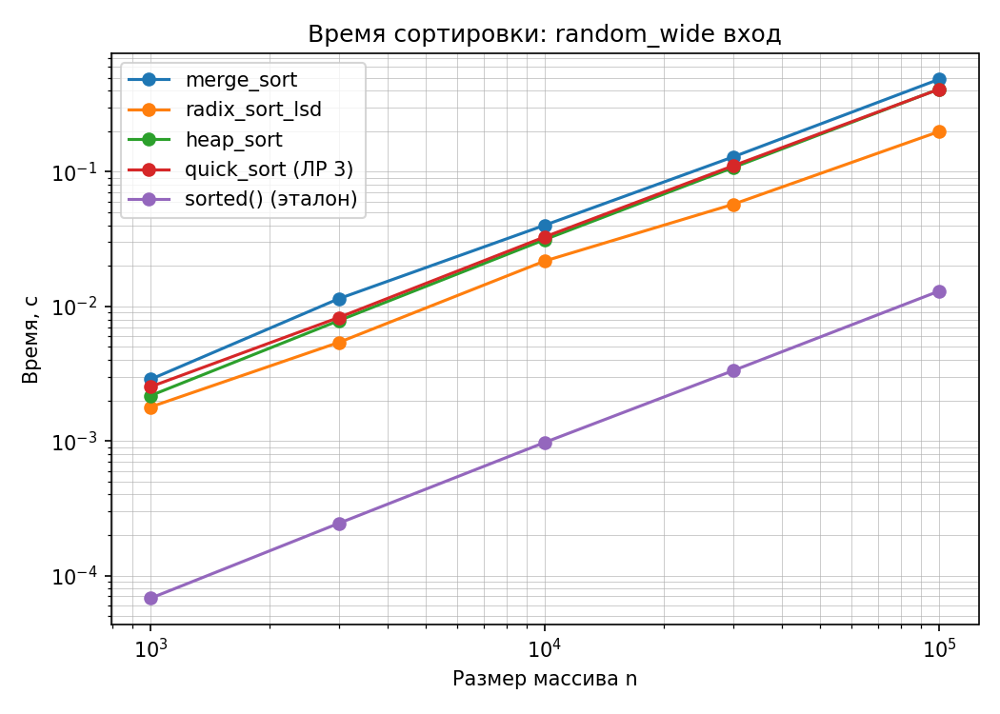
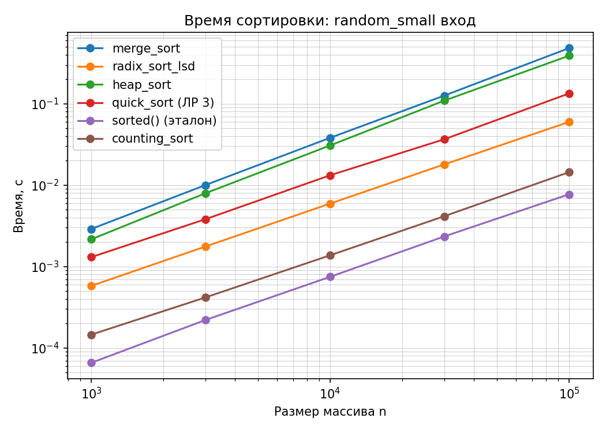
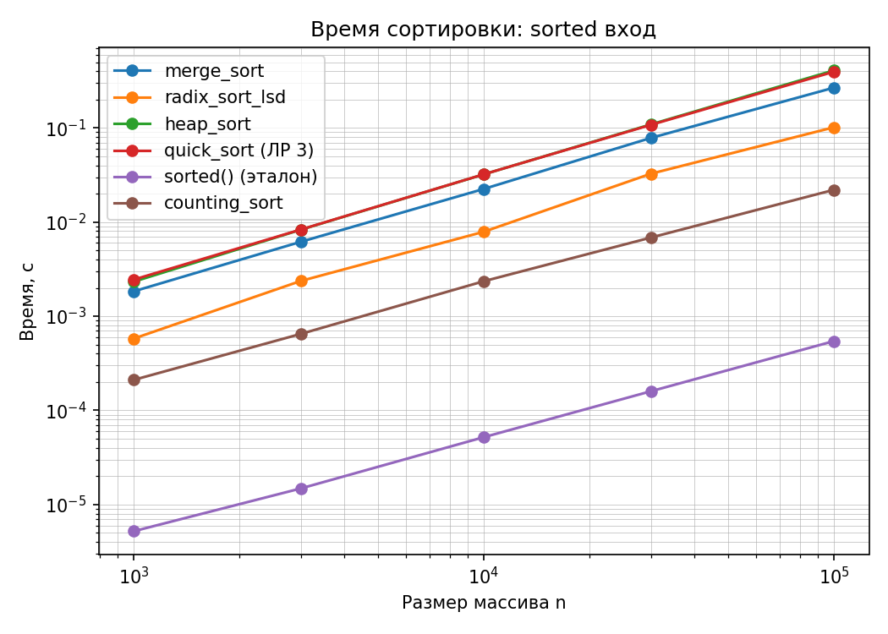
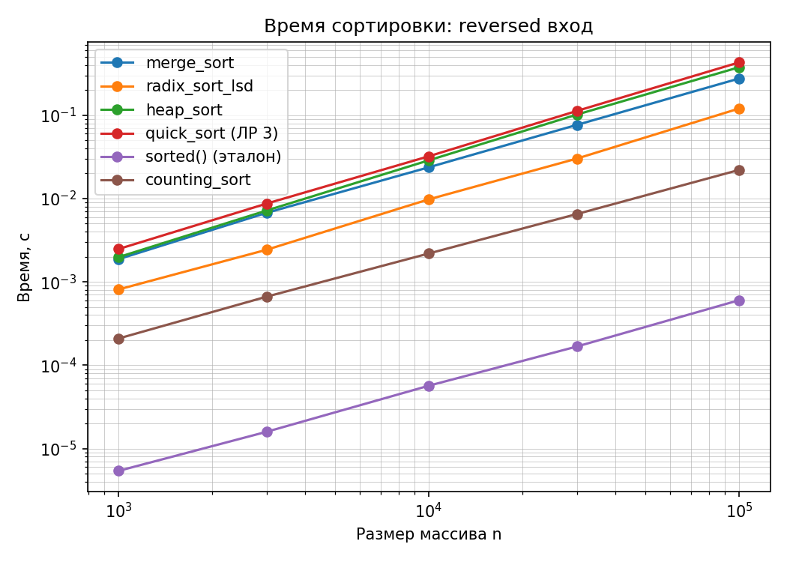
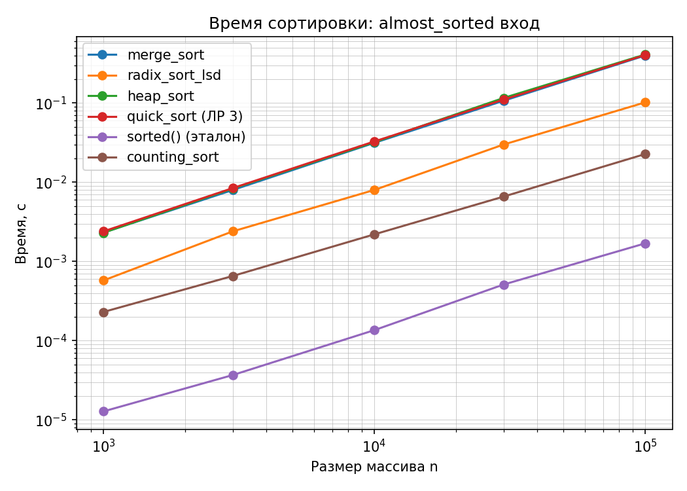

## МИНИСТЕРСТВО ЦИФРОВОГО РАЗВИТИЯ И МАССОВЫХ КОММУНИКАЦИЙ РОССИЙСКОЙ ФЕДЕРАЦИИ
## Ордена трудового Красного Знамени федеральное государственное бюджетное образовательное учреждение "Московский технический университет связи и информатики"

### Отчет по лабораторной работе №4: "MergeSort, Counting, Radix и HeapSort: оценка производительности"
### **Выполнил**: Студент группы БВТ-2502, Провкин Алексей Сергеевич
___

**Цель**: 
Освоить сортировки с гарантией O(n log n) и линейно-временные сортировки; научиться сопоставлять их свойства (время, память, стабильность, ограничения применимости) и выбирать алгоритм по характеру данных.

___
## Информация:
**Версия Python**: Python 3.10.11

**Процессор**: Intel(R) Core(TM) i5-10500H-CPU (базовая скорость: 2.5 GHz, максимальная скорость: 4.5 GHz)
___
## Ход выполнения работы

1. Реализован алгоритм **MergeSort** с рекурсивным разделением массива на две половины и последующим устойчивым слиянием. При равенстве ключей первым выбирается элемент левой половины. Временная сложность — O(n log n), дополнительная память — O(n).

2. Реализован **CountingSort** для неотрицательных целых чисел. Алгоритм использует массив частот, вычисление префиксных сумм и обратный проход по исходному массиву для устойчивой расстановки элементов. Время и дополнительная память — O(n + k), где k — количество допустимых значений ключа.

3. Реализован **RadixSort LSD** с обработкой десятичных разрядов от младшего к старшему. Каждый разряд сортируется устойчивым подсчётом. Временная сложность составляет O(dn), где d — количество обрабатываемых разрядов, дополнительная память — O(n).

4. Реализован **HeapSort** с использованием max-кучи. Построение кучи осуществляется снизу вверх через функцию `sift_down()`, после чего максимальные элементы последовательно перемещаются в конец массива. Временная сложность — O(n log n), дополнительная память — O(1).

5. Перенесён **QuickSort** из лабораторной работы №3. В ходе экспериментов исходная двухсторонняя схема разделения приводила к превышению глубины рекурсии на данных с большим количеством повторяющихся элементов. Для устранения проблемы реализовано трёхстороннее разделение на элементы меньше, равные и больше опорного.

6. Выполнено сравнение пяти реализованных сортировок со встроенной функцией Python `sorted()`.

---

## Проверка корректности алгоритмов

Для верификации использована функция `self_check()`, включающая проверку результатов всех пяти алгоритмов.

Проверялись следующие условия:

- Результат сортировки упорядочен по неубыванию.
- Выходной массив содержит те же элементы с той же кратностью, что и исходный.
- Результаты совпадают с эталонной функцией `sorted()`.
- Алгоритмы корректно обрабатывают пустые массивы, массивы из одного элемента, одинаковые значения, упорядоченные и обратно упорядоченные последовательности.

Для каждого алгоритма выполнена сверка с эталоном на 200 случайных массивах.

Дополнительно реализованы проверки:

- **Устойчивости MergeSort:** сортировка пар «ключ, порядковый номер» с контролем сохранения относительного порядка одинаковых ключей.
- **Свойства max-кучи:** проверка, что после построения кучи каждый родитель не меньше своих существующих детей.
- **Устойчивости поразрядного прохода RadixSort:** использование целочисленных элементов с дополнительными метками для проверки сохранения порядка равных ключей.

**Результат выполнения:**

```text
self_check:
  merge_sort: OK
  counting_sort: OK
  radix_sort_lsd: OK
  heap_sort: OK
  quick_sort: OK
  стабильность merge_sort: OK
  свойство max-кучи: OK
  устойчивость radix: OK
self_check: OK
```

Все проверки завершились успешно.

---

## Сводная таблица свойств алгоритмов

| Алгоритм | Лучший случай | Средний случай | Худший случай | Дополнительная память | Стабильность |
|---|---|---|---|---|---|
| MergeSort | O(n log n) | O(n log n) | O(n log n) | O(n) | Да |
| CountingSort | O(n + k) | O(n + k) | O(n + k) | O(n + k) | Да |
| RadixSort LSD | O(dn) | O(dn) | O(dn) | O(n) | Да |
| HeapSort | O(n log n) | O(n log n) | O(n log n) | O(1) | Нет |
| QuickSort | O(n log n) | O(n log n), ожидаемое | O(n²) | O(n) в данной реализации | Нет |
| sorted() | O(n) | O(n log n) | O(n log n) | O(n) | Да |

Обозначения: n — число элементов, k — количество допустимых значений ключей, d — количество десятичных разрядов.

### Ограничения применимости

**MergeSort:** требует O(n) дополнительной памяти для промежуточных списков и слияния.

**CountingSort:** эффективен при небольшом диапазоне целочисленных ключей. При большом k затраты памяти и времени на массив счётчиков могут превышать затраты на обработку исходных данных.

**RadixSort LSD:** реализован для неотрицательных целых чисел. Время выполнения зависит от количества разрядов максимального числа. Для корректной работы необходима устойчивость каждого поразрядного прохода.

**HeapSort:** сортирует массив на месте и гарантирует O(n log n), однако не сохраняет относительный порядок элементов с равными ключами.

**QuickSort:** при неудачных разбиениях возможна квадратичная сложность. Рандомизация опорного элемента и трёхстороннее разделение уменьшают влияние повторяющихся значений.

**sorted():** встроенная стабильная сортировка Python, использующая Timsort и оптимизированная для частично упорядоченных данных.

---

## Измерения времени работы

Выполнено экспериментальное сравнение шести алгоритмов на массивах размеров:

`1000, 3000, 10000, 30000, 100000`.

Исследованы пять распределений:

1. `random_wide` — случайные числа от 0 до 10⁹.
2. `random_small` — случайные числа от 0 до 100.
3. `sorted` — упорядоченная последовательность.
4. `reversed` — обратно упорядоченная последовательность.
5. `almost_sorted` — почти упорядоченный массив с приблизительно 1% случайных обменов.

Перед измерениями выполнялся прогрев алгоритма. Для каждого набора данных проводилось пять повторений с использованием свежих копий исходного массива, после чего вычислялась медиана.

На распределении `random_wide` CountingSort пропускался из-за чрезмерного объёма памяти, необходимого для хранения счётчиков.

### Результаты при n = 100000

Время в секундах.

| Алгоритм | random_wide | random_small | sorted | reversed | almost_sorted |
|---|---:|---:|---:|---:|---:|
| MergeSort | 0,486483 | 0,487381 | 0,302436 | 0,308726 | 0,432475 |
| CountingSort | — | 0,017619 | 0,026024 | 0,024328 | 0,024551 |
| RadixSort LSD | 0,219946 | 0,065641 | 0,136917 | 0,139110 | 0,116590 |
| HeapSort | 0,511687 | 0,403447 | 0,462017 | 0,436975 | 0,441233 |
| QuickSort | 0,437192 | 0,129440 | 0,500931 | 0,422662 | 0,420449 |
| sorted() | 0,013102 | 0,007981 | 0,000567 | 0,000731 | 0,005009 |

Полные результаты измерений приведены в файле `test_result.txt`.

---

## Графики

Для визуального сравнения предусмотрено построение пяти графиков зависимости времени выполнения от размера входного массива в логарифмическом масштабе по обеим осям (log-log).

Графики создаются с помощью библиотеки `matplotlib` и сохраняются в формате PNG.

### Случайные числа с широким диапазоном



### Случайные числа с узким диапазоном



### Упорядоченный вход



### Обратно упорядоченный вход



### Почти упорядоченный вход



---

## Анализ экспериментальных результатов

### Анализ CountingSort

На распределении `random_small` CountingSort продемонстрировал наименьшее время выполнения среди реализованных вручную алгоритмов.

При n = 100000 время выполнения составило **0,017619 с**, тогда как MergeSort потребовалось 0,487381 с.

Причина заключается в небольшом диапазоне ключей: для чисел от 0 до 100 требуется всего 101 счётчик. Время работы практически линейно зависит от количества входных элементов.

На `random_wide` применение CountingSort нецелесообразно из-за необходимости создания массива счётчиков размером до 10⁹ элементов.

Таким образом, эффективность CountingSort определяется не только размером массива, но и диапазоном его значений.

### Анализ RadixSort LSD

На распределении `random_small` RadixSort показал время **0,065641 с** при n = 100000.

На `random_wide` время составило 0,219946 с.

Разница объясняется количеством обрабатываемых разрядов: небольшие числа требуют до трёх проходов, тогда как числа до 10⁹ могут потребовать до десяти.

Каждый проход обрабатывает весь массив, поэтому увеличение числа разрядов приводит к увеличению общего времени выполнения.

На широком диапазоне RadixSort оказался быстрее MergeSort, HeapSort и QuickSort в данном эксперименте.

### Анализ MergeSort

MergeSort продемонстрировал рост времени выполнения при увеличении размера массива, согласующийся с оценкой O(n log n).

При n = 100000 время выполнения составило:

- `random_wide` — 0,486483 с;
- `random_small` — 0,487381 с;
- `sorted` — 0,302436 с;
- `reversed` — 0,308726 с.

Алгоритм сохраняет одинаковую асимптотическую сложность для всех классов входов, поскольку массив разделяется пополам независимо от расположения элементов.

Различия фактического времени могут объясняться количеством выполняемых сравнений при слиянии и накладными расходами реализации.

### Анализ HeapSort

HeapSort продемонстрировал относительно близкое время выполнения на всех пяти распределениях.

При n = 100000 результаты находились в диапазоне от 0,403447 до 0,511687 с.

Это согласуется с устройством алгоритма: независимо от исходного порядка требуется построить max-кучу, а затем последовательно извлекать максимальные элементы с восстановлением свойства кучи.

Основное преимущество HeapSort — гарантированная сложность O(n log n) при использовании O(1) дополнительной памяти.

### Анализ QuickSort

Первоначальная реализация QuickSort использовала двухстороннее разбиение относительно случайного опорного элемента.

При выполнении бенчмарка `random_small` с большим количеством повторяющихся значений возникла ошибка `RecursionError: maximum recursion depth exceeded`.

Причиной стали несбалансированные разбиения: элементы, равные опорному, повторно попадали в рекурсивные вызовы.

После перехода на трёхстороннее разделение элементы меньше, равные и больше опорного стали обрабатываться отдельно, причём равные значения исключались из дальнейшей рекурсии.

В результате повторные тесты и бенчмарки завершились успешно.

На `random_small` при n = 100000 QuickSort показал время 0,129440 с, тогда как на `random_wide` — 0,437192 с.

Разница объясняется эффективной группировкой повторяющихся ключей в трёхстороннем разделении.

### Сравнение со встроенной sorted()

Встроенная функция `sorted()` показала наименьшее время выполнения среди всех исследованных алгоритмов.

На упорядоченном массиве из 100000 элементов время составило **0,000567 с**, тогда как для HeapSort — 0,462017 с.

Причина заключается в применении оптимизированного алгоритма Timsort, который способен эффективно использовать уже существующие упорядоченные участки массива, а также в реализации основных операций на C.

При этом высокая фактическая производительность не отменяет теоретические оценки сложности других алгоритмов.

---

## Инварианты

### MergeSort

Во время слияния список `result` содержит уже обработанные элементы в неубывающем порядке. При равенстве ключей предпочтение отдаётся элементу левой половины, что обеспечивает устойчивость.

### CountingSort

После подсчёта частот массив `counts` отражает количество вхождений каждого ключа. После вычисления префиксных сумм значения определяют границы размещения элементов в выходном массиве.

Обратный обход исходных данных обеспечивает сохранение относительного порядка элементов с равными ключами.

### RadixSort LSD

После каждого устойчивого поразрядного прохода элементы упорядочены по уже обработанным младшим разрядам. Благодаря устойчивости предыдущий порядок не нарушается при обработке следующего разряда.

### HeapSort

Во время построения max-кучи для каждого родителя выполняется условие, что он не меньше своих детей.

После каждой итерации сортировки максимальный элемент текущей кучи перемещается в конец рабочей части массива. Суффикс массива содержит уже отсортированные элементы, которые больше не участвуют в просейке.

### QuickSort

При трёхстороннем разделении элементы распределяются относительно опорного ключа на три области: меньше, равны и больше.

После завершения разделения рекурсивно обрабатываются только области с меньшими и большими значениями, что позволяет избежать повторной обработки элементов, равных опорному.

---

## Вывод

В ходе лабораторной работы реализованы и исследованы алгоритмы MergeSort, CountingSort, RadixSort LSD и HeapSort. Выполнено их сравнение с QuickSort и встроенной сортировкой Python `sorted()`.

Проведённые эксперименты показали, что фактическая производительность сортировки зависит не только от асимптотической сложности, но и от диапазона ключей, количества повторений, исходного порядка элементов и особенностей реализации.

CountingSort продемонстрировал высокую эффективность на узком диапазоне целочисленных ключей, однако его применение ограничено объёмом памяти, необходимой для массива счётчиков.

RadixSort оказался эффективным при сортировке неотрицательных целых чисел, причём количество разрядов непосредственно влияло на время выполнения.

MergeSort и HeapSort продемонстрировали поведение, согласующееся с гарантированной сложностью O(n log n). При этом HeapSort не требует вспомогательного массива, в отличие от MergeSort.

Для QuickSort экспериментально обнаружена проблема большого количества повторяющихся ключей, устранённая посредством трёхстороннего разделения.

Встроенная `sorted()` показала наименьшее время выполнения во всех исследованных условиях.

Корректность алгоритмов подтверждена тестированием на случайных и граничных входах, сравнением с эталонной сортировкой и дополнительными проверками устойчивости и свойства кучи.

Таким образом, результаты работы демонстрируют, что выбор алгоритма сортировки должен учитывать не только размер массива, но и характеристики входных данных, ограничения памяти и требования к устойчивости.

---

## Использование ИИ

При выполнении лабораторной работы использовалась модель ChatGPT.

Генеративный ИИ применялся для объяснения принципов работы алгоритмов, помощи в реализации и отладке, анализа обнаруженной ошибки рекурсии QuickSort, разработки дополнительных тестов и подготовки отчёта.

Полученные реализации проверены с использованием `self_check()`, сравнением с `sorted()` и экспериментальными замерами времени выполнения.